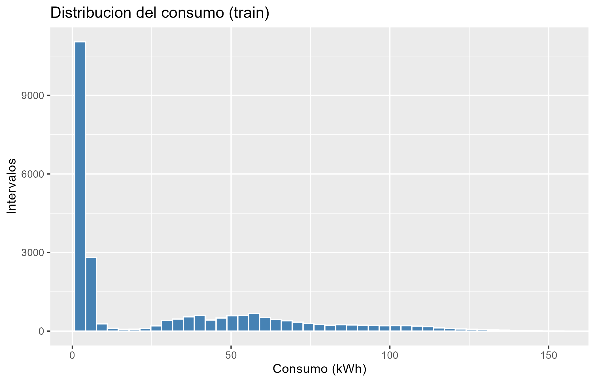
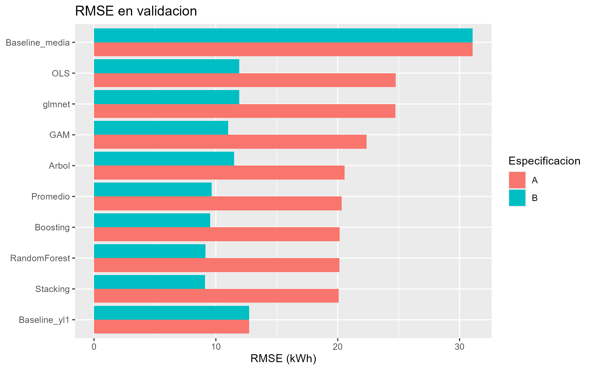
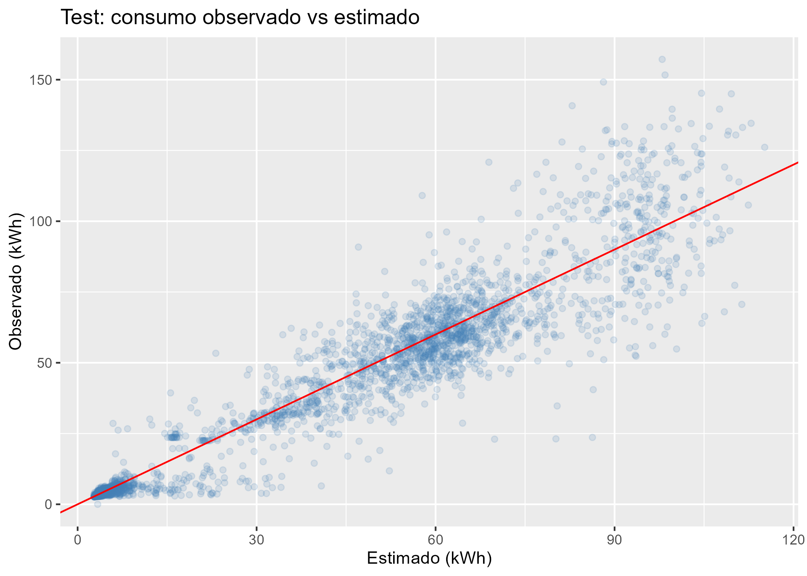
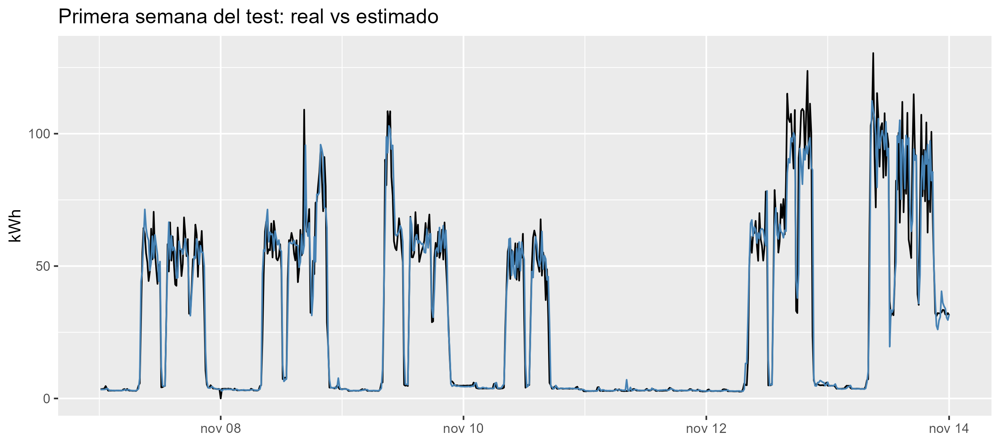

# Caso1-Regresion-Siderurgica
Caso de Estudio Nº 1: Predicción del Consumo Eléctrico de una Siderúrgica
# Caso de Estudio Nº 1: Predicción del Consumo Eléctrico en Industria Siderúrgica

## 📌 1. Descripción y Enunciado del Proyecto
Este proyecto aborda la predicción del consumo eléctrico (en kWh) de una planta siderúrgica en intervalos de 15 minutos utilizando técnicas de regresión, GAM y algoritmos de Machine Learning (Árboles de decisión, Random Forest y Gradient Boosting). 

El objetivo es predecir la demanda de energía $t+1$ a partir de la información del calendario e información histórica rezagada, optimizando los costos operativos y reduciendo desbalances de carga.

---

## 🛠️ 2. Estructura del Repositorio
* `Codigo_Ordenado_final.R`: Script principal en R que ejecuta la limpieza, validación cruzada agrupada (5 folds) y evaluación de modelos.
* `Steel_industry_data.csv`: Dataset original de la industria siderúrgica.
* `Informe_Caso_1.pdf`: Informe final del caso de estudio.
* `Presentacion_Caso_1.pptx`: Diapositivas para la presentación oral.
* `/resultados`: Carpeta que contiene los gráficos generados y las tablas de métricas exportadas.

---

## 📊 3. Visualización Directa de Resultados

### Distribución del Consumo

### Comparación de Modelos (RMSE en Validación)

### Desempeño en Test (Real vs Estimado)

### Serie Temporal - Primera Semana de Prueba

---

## 💻 4. Instrucciones para Reproducir el Código
1. Clonar o descargar este repositorio.
2. Asegurarse de tener instalado R (versión 4.0 o superior).
3. Abrir R / RStudio y verificar que el archivo `Steel_industry_data.csv` esté en la misma carpeta del script.
4. Ejecutar `Codigo_Ordenado_final.R`. El script creará automáticamente la carpeta `/resultados` y guardará los outputs.
